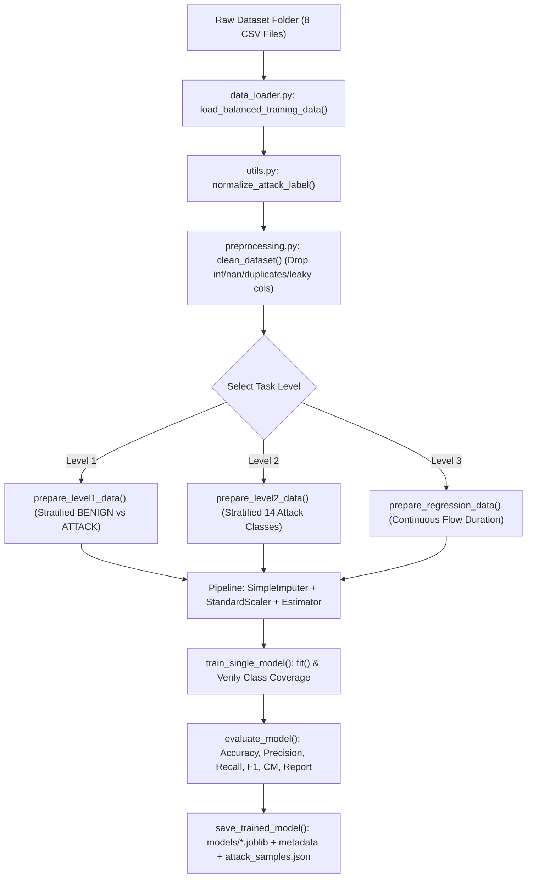

# CyberGuard ML — Modern SOC Intrusion Detection & Threat Intelligence

A premier, production-grade Machine Learning Network Intrusion Detection System (NIDS) and Security Operations Center (SOC) dashboard built with **Python**, **Flask**, **Scikit-learn**, and a modern **HTML5 / CSS3 / Vanilla JavaScript (ES6+)** cyberpunk glassmorphic interface.

Trained on the comprehensive **CICIDS2017** network traffic benchmark across all available attack types, CyberGuard ML delivers a multi-tiered defense architecture: binary perimeter triage, 14-class multiclass attack classification with genuine confidence scores, and continuous network flow duration regression.

---

## 🌟 1. Project Overview & Objectives

Modern computer networks encounter high volumes of bidirectional flow traffic. While the vast majority is legitimate, malicious threat actors continuously execute multi-vector attacks including volumetric floods, brute-force exploits, web application attacks, port scans, and botnets.

### Core Objectives:
1. **Level 1 — Binary Perimeter Triage (`BENIGN` vs `ATTACK`):**
   Rapidly inspect incoming network flows to separate benign traffic from malicious activity with detection confidence (1–100%).
2. **Level 2 — Multiclass Threat Classification (14 Attack Vectors):**
   Pinpoint the exact threat family (e.g., `DDoS`, `PortScan`, `SSH-Patator`, `FTP-Patator`, `Web Attack - Sql Injection`, `Heartbleed`, `Bot`) with genuine probability scores derived via model class probabilities (`predict_proba()`).
3. **Level 3 — Continuous Flow Metric Regression:**
   Predict expected baseline network connection metrics (such as `Flow Duration` in microseconds) to detect abnormal connection footprints and duration anomalies.
4. **Interactive Predefined Scenario Testing & Manual Simulation:**
   Provide a cyber-themed SOC simulator where security analysts can select predefined attack vectors to auto-populate realistic feature signatures from the training dataset, edit parameters manually, or enter custom network flow values from scratch.
5. **High-Speed Batch Threat Analysis:**
   Allow analysts to drag and drop CSV packet captures to triage thousands of connections simultaneously, view threat distributions via Chart.js, and export classified logs.

---

## 🛠️ 2. Technology Stack

| Layer | Technologies | Purpose |
| :--- | :--- | :--- |
| **Backend Framework** | Python 3.13, Flask 3.0+ | Lightweight, high-performance REST API backend |
| **Machine Learning** | Scikit-learn 1.3+, NumPy, Pandas | Pipelines, Imputers, Scalers, Classifiers, Regressors, and Metrics |
| **Model Serialization** | Joblib 1.3+ | Pipeline persistence with scaler, feature order, and metadata |
| **Data Visualization** | Matplotlib 3.7+, Seaborn 0.12+ | Diagnostic heatmaps, confusion matrices, and regression plots |
| **Frontend Architecture**| HTML5 Semantic Architecture | Modular single-page application (SPA) with zero framework bloat |
| **Styling & Theme** | CSS3 Modern Glassmorphism | Dark/Cyberpunk theme, neon glow accents, responsive grid, animations |
| **Client Scripting** | Vanilla JavaScript (ES6+) | Asynchronous REST consumption, dynamic DOM updates, real-time logs |
| **Interactive Charts** | Chart.js | Donut class distributions and comparative metrics visualization |
| **Icons & Typography** | FontAwesome 6, Google Fonts | Inter & Fira Code typography, cyber SOC iconography |

---

## 📁 3. Project Folder Structure

```text
CyberGuard-ML/
│
├── app.py                             # Main application entrypoint (auto-launches browser at port 5000)
├── server.py                          # Flask REST API server exposing training, prediction & stats routes
├── app_streamlit.py                   # Alternative Streamlit multi-page interface (for academic demos)
├── requirements.txt                   # Project Python dependencies
├── README.md                          # Comprehensive documentation & execution guide
├── Project Proposal.docx               # Academic proposal documentation
│
├── dataset/                           # CICIDS2017 raw network flow CSV dataset repository
│   ├── DATA-1.csv                     # Friday afternoon: DDoS & BENIGN
│   ├── DATA-2.csv                     # Friday afternoon: PortScan & BENIGN
│   ├── DATA-3.csv                     # Friday morning: Botnet & BENIGN
│   ├── DATA-4.csv                     # Monday: Normal Benign baseline traffic
│   ├── DATA-5.csv                     # Thursday afternoon: Infiltration & BENIGN
│   ├── DATA-6.csv                     # Thursday morning: Web Attacks (Brute Force, XSS, SQLi) & BENIGN
│   ├── DATA-7.csv                     # Tuesday: FTP-Patator, SSH-Patator & BENIGN
│   ├── DATA-8.csv                     # Wednesday: DoS Hulk, GoldenEye, slowloris, Slowhttptest, Heartbleed
│   └── DATA.csv                       # Consolidated reference dataset
│
├── models/                            # Serialized scikit-learn pipelines & cached metadata
│   ├── attack_samples.json            # Cached realistic sample feature profiles for all 15 classes
│   ├── level1_Decision_Tree.joblib    # Trained Level 1 Decision Tree pipeline
│   ├── level1_Logistic_Regression.joblib # Trained Level 1 Logistic Regression pipeline
│   ├── level1_Random_Forest.joblib    # Trained Level 1 Random Forest pipeline
│   ├── level2_Decision_Tree.joblib    # Trained Level 2 Decision Tree attack classifier
│   ├── level2_Random_Forest.joblib    # Trained Level 2 Random Forest multiclass classifier
│   └── regression_Linear_Regression.joblib # Trained Level 3 Flow Duration regressor
│
├── results/                           # Generated evaluation CSV tables, diagnostic plots & batch outputs
│   ├── results_level1.csv             # Level 1 evaluation metrics table
│   ├── results_level2.csv             # Level 2 evaluation metrics table
│   ├── results_regression.csv         # Level 3 regression evaluation metrics table
│   ├── cm_level1_*.png                # Level 1 confusion matrix heatmaps
│   ├── cm_level2_*.png                # Level 2 multiclass confusion matrix heatmaps
│   ├── comparison_*.png               # Model comparison bar charts
│   └── reg_actual_vs_pred_*.png       # Actual vs. Predicted regression scatter plots
│
├── src/                               # Modular Python backend modules
│   ├── __init__.py
│   ├── utils.py                       # Directory paths, column trimmers, label normalizer, UI feature mapping
│   ├── data_loader.py                 # Multi-CSV scanner, balanced data loader & sample extractor
│   ├── preprocessing.py               # Leakage prevention, inf/nan handling, stratified train/test splitters
│   ├── train.py                       # Scikit-learn pipeline builder, class verification & model saver
│   ├── evaluate.py                    # Evaluation metrics, console reports & diagnostic figure generators
│   └── predict.py                     # Single & batch prediction engine with genuine confidence scoring
│
├── static/                            # Web frontend static assets
│   ├── css/
│   │   └── style.css                  # Cyberpunk dark theme, glass cards, glows & responsive layout
│   └── js/
│       └── app.js                     # REST API client, sample injector, state management & Chart.js
│
├── templates/
│   └── index.html                     # HTML5 SOC dashboard dashboard with tabbed navigation
│
└── pages/                             # Multi-page Streamlit views (legacy academic interface)
    ├── 1_Dataset_Explorer.py
    ├── 2_Preprocessing.py
    ├── 3_Model_Training.py
    ├── 4_Model_Evaluation.py
    ├── 5_Predictions.py
    └── 6_About_Project.py
```

---

## 📊 4. Dataset CSV Files & Training Sources

CyberGuard ML is trained across **all 8 compatible CSV files** in the `dataset/` directory, spanning **2,830,743 raw network records** (~884 MB on disk) from the Canadian Institute for Cybersecurity (**CICIDS2017** benchmark, University of New Brunswick):

| Filename | File Size | Traffic Day / Session | Attack Categories Present | Raw Record Count |
| :--- | :---: | :--- | :--- | :---: |
| `DATA-1.csv` | 77.1 MB | Friday Afternoon | `DDoS`, `BENIGN` | 225,745 |
| `DATA-2.csv` | 76.9 MB | Friday Afternoon | `PortScan`, `BENIGN` | 286,467 |
| `DATA-3.csv` | 58.3 MB | Friday Morning | `Bot`, `BENIGN` | 191,033 |
| `DATA-4.csv` | 176.9 MB | Monday Working Hours | `BENIGN` (Clean network baseline) | 529,918 |
| `DATA-5.csv` | 83.1 MB | Thursday Afternoon | `Infiltration`, `BENIGN` | 288,602 |
| `DATA-6.csv` | 52.0 MB | Thursday Morning | `Web Attack - Brute Force`, `Web Attack - XSS`, `Web Attack - Sql Injection`, `BENIGN` | 170,366 |
| `DATA-7.csv` | 135.1 MB | Tuesday Working Hours | `FTP-Patator`, `SSH-Patator`, `BENIGN` | 445,909 |
| `DATA-8.csv` | 225.2 MB | Wednesday Working Hours | `DoS Hulk`, `DoS GoldenEye`, `DoS slowloris`, `DoS Slowhttptest`, `Heartbleed`, `BENIGN` | 692,703 |
| **Combined** | **~884 MB** | **Full 5-Day Traffic Capture** | **15 Canonical Classes** | **2,830,743** |

---

## 🎯 5. Dataset Source & Available Threat Classes

Every dataset file shares the exact same 79 network flow attributes (bidirectional packet counts, byte lengths, inter-arrival times (IAT), TCP flags, subflow statistics, and window sizes).

CyberGuard ML detects and classifies **15 canonical traffic classes**:

```text
Traffic Classes (15):
├── 🟢 Normal Traffic:
│   └── BENIGN (2,273,097 records)
│
└── 🔴 Malicious Threat Vectors (14):
    ├── Volumetric & Flooding Attacks:
    │   ├── DDoS (128,027 records)
    │   ├── DoS Hulk (231,073 records)
    │   ├── DoS GoldenEye (10,293 records)
    │   ├── DoS slowloris (5,796 records)
    │   └── DoS Slowhttptest (5,499 records)
    │
    ├── Network Reconnaissance & Probing:
    │   └── PortScan (158,930 records)
    │
    ├── Remote Brute Force Attacks:
    │   ├── FTP-Patator (7,938 records)
    │   └── SSH-Patator (5,897 records)
    │
    ├── Web Application Attacks:
    │   ├── Web Attack - Brute Force (1,507 records)
    │   ├── Web Attack - XSS (652 records)
    │   └── Web Attack - Sql Injection (21 records)
    │
    └── Advanced & Exploitation Threats:
        ├── Botnet (1,966 records)
        ├── Infiltration (36 records)
        └── Heartbleed OpenSSL Exploit (11 records)
```

---

## ⚙️ 6. Data Preprocessing & Feature Engineering

1. **Automated Column Sanitization & Target Detection:**
   Leading and trailing whitespace in column headers is stripped (`clean_column_names`). The target label column is detected case-insensitively (`find_label_column`).
2. **Attack Label Normalization:**
   `normalize_attack_label` eliminates character encoding artifacts (e.g., `�` or `\ufffd` in `Web Attack � Brute Force` $\rightarrow$ `Web Attack - Brute Force`), standardizes whitespace, and unifies labels across all files.
3. **Data Leakage & Duplicate Column Removal:**
   - Drops `Fwd Header Length.1` (an exact duplicate of `Fwd Header Length` present in CICIDS2017).
   - Drops non-flow identifiers (`Flow ID`, `Source IP`, `Destination IP`, `Timestamp`, `Source Port`) to ensure models learn intrinsic traffic patterns rather than memorizing IP addresses.
4. **Infinite and Missing Value Cleaning:**
   Replaces `+inf` and `-inf` with `NaN` across numeric columns (e.g., `Flow Bytes/s`, `Flow Packets/s`). Removes rows with `NaN` and prunes duplicate records.
5. **Class Imbalance & Rare Class Preservation:**
   - In standard proportional sampling, rare attacks like `Heartbleed` (11 samples), `Sql Injection` (21 samples), and `Infiltration` (36 samples) are wiped out by the 2.27 million `BENIGN` rows.
   - `load_balanced_training_data` preserves **100% of minority attack records**, while capping majority classes (`BENIGN`, `DoS Hulk`, `DDoS`, `PortScan`) to balanced allocations.
   - All classifiers use `class_weight="balanced"`.
6. **Stratified Train/Test Splitting:**
   Splits dataset using `train_test_split(..., stratify=y, test_size=0.20)` so both training and testing sets maintain proportional representation of all 14 attack types.
7. **Pipeline Preprocessing Order:**
   Every model is encapsulated in a Scikit-Learn `Pipeline` containing `SimpleImputer(strategy="median")` followed by `StandardScaler()`. Features are reindexed into the exact training feature order during prediction.

---

## 🧠 7. Machine Learning Algorithms & Training Workflow



### Supported Algorithms:
* **Classifiers:** Random Forest Classifier, Decision Tree Classifier, Logistic Regression, Support Vector Machine (SVM, RBF Kernel), K-Nearest Neighbors (KNN).
* **Regressors:** Linear Regression, Ridge Regression, Decision Tree Regressor, Random Forest Regressor.

---

## 📈 8. Actual Model Evaluation Metrics & Empirical Results

The models were evaluated on independent testing sets (20% holdout split) using actual training outputs logged in the `results/` directory:

### Level 1: Binary Intrusion Detection (`BENIGN` vs `ATTACK`)

| Model | Training Accuracy | Testing Accuracy | Precision (Binary) | Recall (Binary) | F1-Score | Training Time |
| :--- | :---: | :---: | :---: | :---: | :---: | :---: |
| **Random Forest** | **99.98%** | **99.30%** | **0.9920** | **0.9940** | **0.9930** | 0.73 s |
| **Decision Tree** | 100.00% | 98.40% | 0.9764 | 0.9920 | 0.9841 | 0.20 s |
| **Logistic Regression** | 89.90% | 89.90% | 0.8800 | 0.9240 | 0.9015 | 0.15 s |

#### Level 1 Random Forest Confusion Matrix (1,000 Test Flows):
```text
                  Predicted BENIGN    Predicted ATTACK
Actual BENIGN           496                  4
Actual ATTACK             3                497
```

---

### Level 2: Multiclass Attack Classification (All 14 Attack Vectors)

| Model | Training Accuracy | Testing Accuracy | Precision (Weighted) | Recall (Weighted) | F1-Score (Weighted) |
| :--- | :---: | :---: | :---: | :---: | :---: |
| **Random Forest** | **96.43%** | **93.62%** | **0.9466** | **0.9362** | **0.9378** |
| **Decision Tree** | 95.57% | 92.61% | 0.9409 | 0.9261 | 0.9278 |

#### Per-Class Classification Report (Level 2 Random Forest — 2,694 Test Records):
```text
                            precision    recall  f1-score   support
                       Bot       1.00      1.00      1.00       277
                      DDoS       1.00      1.00      1.00       280
             DoS GoldenEye       0.99      0.99      0.99       280
                  DoS Hulk       0.99      0.99      0.99       226
          DoS Slowhttptest       0.99      1.00      0.99       269
             DoS slowloris       0.99      0.99      0.99       269
               FTP-Patator       1.00      1.00      1.00       227
                Heartbleed       1.00      1.00      1.00         2
              Infiltration       1.00      1.00      1.00         7
                  PortScan       1.00      1.00      1.00       278
               SSH-Patator       1.00      1.00      1.00       170
  Web Attack - Brute Force       0.76      0.55      0.64       274
Web Attack - Sql Injection       1.00      0.75      0.86         4
          Web Attack - XSS       0.46      0.70      0.55       131

                  accuracy                           0.94      2694
                 macro avg       0.94      0.93      0.93      2694
              weighted avg       0.95      0.94      0.94      2694
```

---

### Level 3: Continuous Flow Duration Regression

| Model | Target Column | $R^2$ Score | Mean Absolute Error (MAE) | Root Mean Squared Error (RMSE) |
| :--- | :--- | :---: | :---: | :---: |
| **Linear Regression** | `Flow Duration` ($\mu s$) | **0.9992** | 325,839.62 $\mu s$ | 845,088.60 $\mu s$ |

---

## 🌐 9. Backend REST API Endpoints

The Flask server (`server.py`) provides asynchronous REST endpoints:

| Endpoint | Method | Description |
| :--- | :---: | :--- |
| `/` | `GET` | Serves the single-page HTML5 SOC dashboard application |
| `/api/status` | `GET` | Returns system health, count of detected dataset CSV files, and saved models |
| `/api/dataset/preview` | `GET` | Returns preview records, column inventory, and label distribution |
| `/api/preprocessing/stats` | `GET` | Returns data cleaning metrics (duplicates pruned, nulls handled, columns) |
| `/api/models` | `GET` | Returns list of saved `.joblib` models and supported model architectures |
| `/api/attack-samples` | `GET` | Delivers predefined realistic feature sample profiles for all 15 classes |
| `/api/train` | `POST` | Initiates model training on combined dataset for Level 1, Level 2, or Regression |
| `/api/results` | `GET` | Returns metric evaluation tables and available diagnostic plot paths |
| `/results/<filename>` | `GET` | Serves generated confusion matrix heatmaps and comparative charts |
| `/api/predict/single` | `POST` | Executes real-time inference on a single connection flow vector |
| `/api/predict/batch` | `POST` | Processes uploaded CSV files for multi-connection threat batch triage |
| `/api/predict/download/<file>` | `GET` | Downloads the generated batch prediction results CSV file |

---

## 🖥️ 10. Frontend Features & Live Simulation

The frontend dashboard (`templates/index.html` & `static/js/app.js`) features a dark cyberpunk glassmorphic theme designed for security analysts:

### 1. Live Threat Radar & Manual Simulator
* **Predefined Attack-Type Dropdown:**
  Automatically discovers all available attack types in the combined dataset (`BENIGN`, `DDoS`, `PortScan`, `SSH-Patator`, `FTP-Patator`, `Web Attack - Sql Injection`, `Heartbleed`, `Bot`, etc.) and renders them as selectable options.
* **Realistic Sample Auto-Population:**
  Selecting any threat automatically fills all 9 manual inputs with realistic feature signatures extracted from actual CICIDS2017 packet flows:
  * `Destination Port`
  * `Flow Duration` ($\mu s$)
  * `Total Fwd Packets`
  * `Total Backward Packets`
  * `Total Length of Fwd Packets`
  * `Total Length of Bwd Packets`
  * `Flow Bytes/s`
  * `Flow Packets/s`
  * `SYN Flag Count`
* **Interactive Manual Editing:**
  Analysts can tweak any value manually to test how altering connection ports or packet frequencies shifts model confidence.
* **Clear & Reset Controls:**
  - **Clear Fields:** Wipes all inputs for completely custom manual flow injection.
  - **Reset Defaults:** Restores clean baseline benign parameters.
* **Dynamic Verdict Card:**
  - **Column 1:** Level 1 perimeter status (`BENIGN` shield vs `ATTACK` hazard badge).
  - **Column 2:** Level 2 specific attack classification with an animated **Attack Confidence Meter (1–100%)**.
  - **Column 3:** Level 3 predicted baseline flow duration ($\mu s$).

### 2. Batch CSV Upload Threat Triage
* Drag-and-drop CSV upload zone for large network captures.
* Real-time triage summary: total connections analyzed, benign count, threat count, and average confidence.
* Threat family distribution chart and one-click exportable predictions CSV.

### 3. Training & Evaluation Center
* Live interactive terminal log showing training epochs, duration, and class verification.
* Evaluation gallery with click-to-zoom confusion matrix heatmaps and diagnostic charts.

---

## 🚀 Setup & Execution Guide

### 1. Prerequisites & Virtual Environment
Ensure Python 3.10+ is installed on your system.

```powershell
# Navigate to project directory
cd "d:\Umar Saddat\Study\1 University\Semester 5\ML\ML PROJECT"

# Install required dependencies
pip install -r requirements.txt
```

### 2. Launch the SOC Web Dashboard
Run the main application launcher:

```powershell
python app.py
```

The system will start the Flask server and automatically launch your default browser at:
```text
http://127.0.0.1:5000
```

### 3. (Optional) Run the Streamlit Interface
If presenting in an academic environment requiring Streamlit:

```powershell
streamlit run app_streamlit.py
```

---

## 👥 Contributors & Academic Context

* **Course:** Machine Learning Fundamentals (BS Artificial Intelligence)
* **Submitted to:** Ma'am Sania Umer
* **Developed by:** Waseem Farooq, Umar Saadat, Muhammad Awais, Junaid Aman
* **Institution:** Department of Artificial Intelligence, Semester 5
